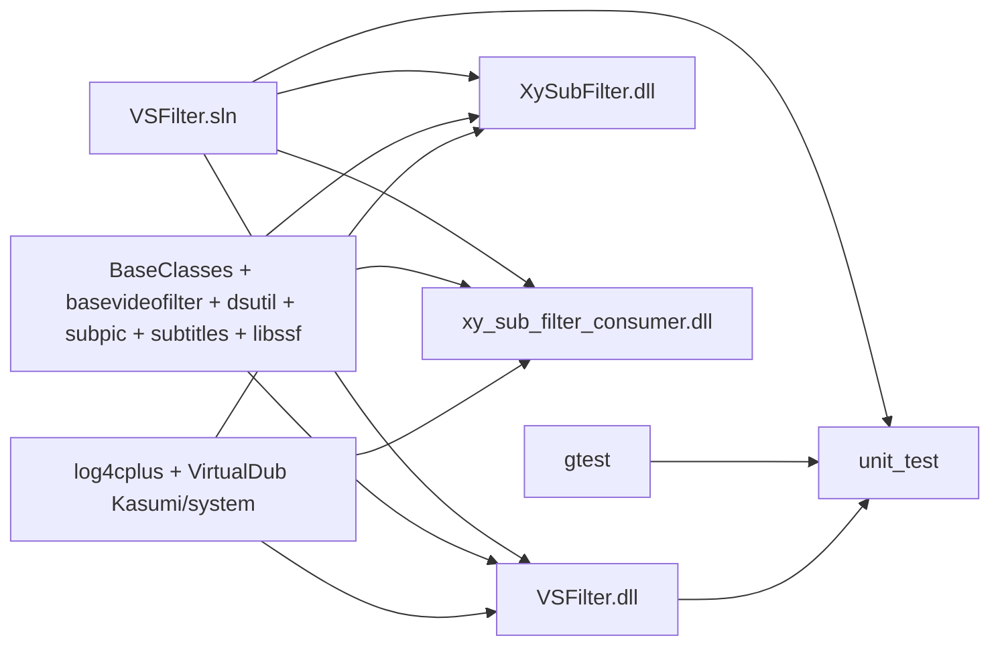
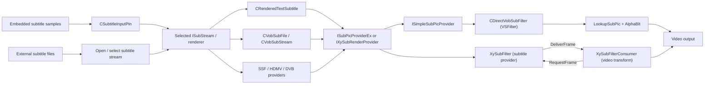

# xy-VSFilter knowledge graph

Scope: the `xy_sub_filter_rc5` branch based on commit `4911cacb102bc0cbd41449793e54473265b04e62`, including local style-hash, ASS parsing/cache, reconstruction/allocation optimizations and benchmark tools. This is a map of the checked-out source, not a claim that every optional format or renderer follows the same path. Edges below describe either solution dependencies or calls and interfaces visible in the linked code.

## Build graph

The arrows into a DLL mean **build dependency**. The shared-library grouping condenses the repeated `ProjectDependencies` entries in [VSFilter.sln](../VSFilter.sln); it does not imply one physical library. The DLL target names and source membership are in [VSFilter.vcxproj](../src/filters/transform/vsfilter/VSFilter.vcxproj), [xy_sub_filter.vcxproj](../src/filters/transform/vsfilter/xy_sub_filter.vcxproj), and [xy_sub_filter_consumer.vcxproj](../src/filters/transform/vsfilter/xy_sub_filter_consumer.vcxproj). The unit test project is [unit_test.vcxproj](../test/unit_test/unit_test.vcxproj).

Release **v3.2.1.900** is defined in [version_in.h](../src/filters/transform/vsfilter/version_in.h), shared by DLL resources and filter options. CI passes `--versioning-off` so the committed release number is preserved. See [release notes](releases/v3.2.1.900.md).

## Runtime graph

The format nodes are alternatives: a selected `ISubStream` represents one subtitle source. The VSFilter and XySubFilter branches are distinct integration paths, although they share parsing, rendering, and options code.

## Nodes and relationships

| Node | Role and outgoing relationship | Primary evidence |
| --- | --- | --- |
| `VSFilter.dll` | DirectShow video transform and Avisynth/CSRI entry points; uses the shared subtitle and subpicture code. | [DirectVobSubFilter.h](../src/filters/transform/vsfilter/DirectVobSubFilter.h), [plugins.cpp](../src/filters/transform/vsfilter/plugins.cpp), [csriapi.cpp](../src/filters/transform/vsfilter/csriapi.cpp) |
| `XySubFilter.dll` | Subtitle provider filter; chooses an `ISubStream`, adapts it to `IXySubRenderProvider`, and sends frames to a consumer. | [xy_sub_filter.h](../src/filters/transform/vsfilter/xy_sub_filter.h), [xy_sub_filter.cpp](../src/filters/transform/vsfilter/xy_sub_filter.cpp) (`SetSubtitle`, `RequestFrame`) |
| `xy_sub_filter_consumer.dll` | Video transform that requests a subtitle frame from `ISubRenderProvider`, receives `DeliverFrame`, and blends the result. | [xy_sub_filter_consumer.h](../src/filters/transform/vsfilter/xy_sub_filter_consumer.h), [xy_sub_filter_consumer.cpp](../src/filters/transform/vsfilter/xy_sub_filter_consumer.cpp) (`Transform`, `DeliverFrame`, `AlphaBlt`) |
| `CSubtitleInputPin` | Accepts embedded subtitle media samples and creates format-specific helpers and streams. | [SubtitleInputPin.h](../src/subtitles/SubtitleInputPin.h), [SubtitleInputPin.cpp](../src/subtitles/SubtitleInputPin.cpp) (`CreateHelper`, `Receive`) |
| `CRenderedTextSubtitle` | Parses and renders text subtitles, including SSA/ASS and WebVTT paths. Implements subtitle stream and subpicture provider interfaces. | [STS.h](../src/subtitles/STS.h), [RTS.h](../src/subtitles/RTS.h), [RTS.cpp](../src/subtitles/RTS.cpp) |
| Bitmap/other subtitle providers | VobSub, SSF, HDMV/PGS, and DVB processing provide other stream/render paths. | [VobSubFile.h](../src/subtitles/VobSubFile.h), [SSF.h](../src/subtitles/SSF.h), [HdmvSub.h](../src/subtitles/HdmvSub.h), [DVBSub.h](../src/subtitles/DVBSub.h), [hdmv_subtitle_provider.h](../src/subtitles/hdmv_subtitle_provider.h) |
| Subpicture abstraction | `ISubPicProvider`, `ISubPicProviderEx`, `ISubPicQueue`, `ISubPic`, and `SubPicDesc` connect renderers to buffers and blending. | [ISubPic.h](../src/subpic/ISubPic.h), [SubPicProviderImpl.h](../src/subpic/SubPicProviderImpl.h), [SubPicQueueImpl.h](../src/subpic/SubPicQueueImpl.h) |
| Compatibility adapters | `SimpleSubPicProvider` services VSFilter lookups; `XySubRenderProviderWrapper` adapts subpicture providers for XySubFilter. | [SimpleSubPicProviderImpl.h](../src/subpic/SimpleSubPicProviderImpl.h), [XySubRenderProviderWrapper.h](../src/subpic/XySubRenderProviderWrapper.h) |
| Shared infrastructure | DirectShow media utilities, base video transform, options/property pages, and COM registration support the DLLs. | [dsutil](../src/dsutil), [BaseVideoFilter.h](../src/filters/transform/basevideofilter/BaseVideoFilter.h), [DirectVobSub.h](../src/filters/transform/vsfilter/DirectVobSub.h), [VSFilter.cpp](../src/filters/transform/vsfilter/VSFilter.cpp) |
| Style sharing and hashes | `CRenderedTextSubtitle::GetSubtitle` creates `FwSTSStyle` values. Boost's shared style table uses `STSStyle::operator==` and `hash_value(STSStyle)`; every equality field participates in the hash. The common double hash canonicalizes signed zero. This code is shared by both runtime paths. | [STS.h](../src/subtitles/STS.h), [STS.cpp](../src/subtitles/STS.cpp), [flyweight_base_types.h](../src/subtitles/flyweight_base_types.h), [RTS.cpp](../src/subtitles/RTS.cpp) |
| Active ASS syntax and text | `GetSubtitle` retains immutable tag blocks, tag/text boundaries and the following raw text with active animated events under a 16 MiB accounted-memory admission limit. A source cursor avoids rebuilding suffix strings on misses. `ExpireParsedTags` releases ended events and resets on backward seeks; text comparison and `OnChanged`/`Deinit` invalidate stale syntax. Cache misses use the existing shared MRU. Numeric conversion is cached while animation evaluation still runs at each timestamp. | [RTS.h](../src/subtitles/RTS.h), [RTS.cpp](../src/subtitles/RTS.cpp), [cache_manager.h](../src/subtitles/cache_manager.h) |
| Frame assembly and ownership | `RenderOneSubtitle` appends final draw-item slots, and `CLine::PaintAll` fills the specified range. `XyFlyWeight` can borrow a value for lookup and retain an owned value on a miss. `DrawItem` and overlay factories return shared ownership directly, allowing combined allocations. Word factories use combined shared allocations, and grouped keys and grouped draw-item sequences keep the first child inline. Grouped bitmap-key lookups borrow a frame-local probe and allocate combined owned storage only on a cache miss. Matching fractional layer positions share immutable geometry keys and painted overlay machines; opaque-box geometry stays distinct from the body. Only requested layers receive keys; dirty-rectangle queries reuse a painted overlay, and unclipped subtitles share a stateless clipper machine. | [RTS.cpp](../src/subtitles/RTS.cpp), [flyweight_base_types.h](../src/subtitles/flyweight_base_types.h), [draw_item.cpp](../src/subtitles/draw_item.cpp), [xy_overlay_paint_machine.cpp](../src/subtitles/xy_overlay_paint_machine.cpp) |
| Polygon geometry reuse | `CPolygon::ParseStr` retains the immutable raw-path owner from the existing bounded `PathDataMruCache`, avoiding fresh vertex arrays. Polygon keys omit font glyph fields; text keys retain them. Reuse requires exact nonzero script scales; current baseline and font-scale metrics are recomputed by `UpdateMetrics`. The cached path stays untransformed and immutable; `PaintFromPathData` transforms a separate copy. | [RTS.cpp](../src/subtitles/RTS.cpp), [cache_manager.h](../src/subtitles/cache_manager.h), [geometry contract](../test/benchmark/render_subtitles.cpp) |
| Word and line storage | `CSubtitle` and `CLine` use `CInlineList`: one element is stored directly, with vector storage for longer sequences. `CLine::Compact` merges text in place and retains single words or polygons without cloning them. The first line and first effect are stored inside `CSubtitle`; extra lines/effects have separate ownership. Line iteration uses an opaque index position. | [RTS.h](../src/subtitles/RTS.h), [RTS.cpp](../src/subtitles/RTS.cpp), [ownership contract](../test/benchmark/render_subtitles.cpp) |
| Stable reconstruction intervals | `CalcAnimation` intersects the constant intervals before/after evaluated transforms and rejects continuously interpolating state. `GetSubtitle` can retain small single-word text/polygon states (at most 16 polygon vertices, bounded strings, no vector/scroll/origin clipper) for that exact interval. Source identity, duration and interval checks guard reuse. Admission is capped at 8,192 entries and a 32 MiB accounted budget, charging 4 KiB per polygon state or 8 KiB per text state; expiry, backward seeking, edits and deinitialization release states. | [RTS.h](../src/subtitles/RTS.h), [RTS.cpp](../src/subtitles/RTS.cpp), [reconstruction contract](../test/benchmark/render_subtitles.cpp) |
| Per-word key retention | `CWord` holds at most three geometry keys and three draw keys. Geometry reuse requires exact string identity, script scales, style and fractional/transform positions. Draw reuse requires matching fields and hashes, preserving the existing MRU lookup semantics. Eviction replaces ownership rather than mutating a key; keys do not own their parent word or rendered images. | [RTS.h](../src/subtitles/RTS.h), [cache_manager.cpp](../src/subtitles/cache_manager.cpp), [xy_overlay_paint_machine.cpp](../src/subtitles/xy_overlay_paint_machine.cpp), [key contract](../test/benchmark/render_subtitles.cpp) |
| Empty event storage | Each `CRenderedTextSubtitle` owns a `CSubtitlePool` bounded by a compile-time 1 MiB storage budget. Animated events release all old content before their storage is reconstructed for reuse; `OnChanged` and `Deinit` clear the pool. Draw items retain word ownership independently. | [RTS.h](../src/subtitles/RTS.h), [RTS.cpp](../src/subtitles/RTS.cpp), [pool contract](../test/benchmark/render_subtitles.cpp) |
| Composition scratch storage | `CompositeDrawItem::Draw` owns one `AlphaMaskBuffer` for synchronous frame composition. Each grouped draw passes it through `DrawItem` into `Rasterizer::CompositeAlphaMask`; the temporary mask is consumed before reuse and is never retained by output bitmaps or caches. Fully transparent single-color draws preserve bounds and skip their pixel no-op. | [draw_item.cpp](../src/subtitles/draw_item.cpp), [Rasterizer.h](../src/subtitles/Rasterizer.h), [Rasterizer.cpp](../src/subtitles/Rasterizer.cpp) |
| Bitmap capacity and identity | Both filter paths and the Avisynth initializer call `CacheManager::SetBitmapCacheSize` for coupled group-key and payload capacities. A zero-capacity MRU retains nothing and returns no position; flyweights keep owned values with fresh identities on bypass. Draw-key hashing includes all six ordered karaoke switch words used by equality. | [cache_manager.cpp](../src/subtitles/cache_manager.cpp), [mru_cache.h](../src/subtitles/mru_cache.h), [flyweight_base_types.h](../src/subtitles/flyweight_base_types.h), [DirectVobSubFilter.cpp](../src/filters/transform/vsfilter/DirectVobSubFilter.cpp), [xy_sub_filter.cpp](../src/filters/transform/vsfilter/xy_sub_filter.cpp) |
| Edge-blur scratch | Integer edge passes share two operation-local `WORD` rows, reset before each pass. Active `BeBlur` has no image-sized temporary. The legacy fixed-point Gaussian branch keeps the temporary it actually reads. No row scratch escapes the synchronous operation. | [Rasterizer.cpp](../src/subtitles/Rasterizer.cpp), [first review implementation](performance-20261026-review-implementation.md) |
| Build and tests | Windows/Visual Studio solution; Git Bash build script targets VS2019 in CI; tests use Google Test. | [build_vsfilter.sh](../build_vsfilter.sh), [build.yml](../.github/workflows/build.yml), [main.cpp](../test/unit_test/main.cpp) |
| Performance validation | Debug Zoom Player playback captures test the default embedded ASS track, recording actual renderer, engine and dependency hashes. The current full-HD cohort uses MPC Video Renderer; historical smaller-window captures used madVR. A separate native console target supports Win32 and x64 and calls the shared `CRenderedTextSubtitle::RenderEx` directly, hashing every bitmap's position, size and visible pixels for comparison. It also tests style hash distribution and signed zero. | [benchmark README](../test/benchmark/README.md), [render_subtitles.cpp](../test/benchmark/render_subtitles.cpp), [render_subtitles.vcxproj](../test/benchmark/render_subtitles.vcxproj), [analyze_cpu_trace.ps1](../test/benchmark/analyze_cpu_trace.ps1) |

## Follow a change through the graph

- **Subtitle format or parsing:** start at `CSubtitleInputPin::CreateHelper` for embedded media types, then `STS`/`RTS`, `VobSubFile`, `SSF`, `HdmvSub`, or `DVBSub` for the relevant format. Check both filter paths if the rendered result changes.
- **Timing, selected stream, or external file discovery:** trace `Open`, `UpdateSubtitle`, and `SetSubtitle` in [DirectVobSubFilter.cpp](../src/filters/transform/vsfilter/DirectVobSubFilter.cpp) and [xy_sub_filter.cpp](../src/filters/transform/vsfilter/xy_sub_filter.cpp).
- **Pixel format or blending:** trace `SubPicDesc` and `ColorType` in [ISubPic.h](../src/subpic/ISubPic.h), the VSFilter `Transform` path, the consumer `Transform`/`AlphaBlt` path, then relevant tests in [test/unit_test](../test/unit_test).
- **Build or exported DLL behavior:** start with the corresponding `.vcxproj` and DLL entry point (`DirectVobSubFilterDll.cpp`, `xy_sub_filter_dll.cpp`, or `xy_sub_filter_consumer_dll.cpp`). [build_vsfilter.sh](../build_vsfilter.sh) defaults to building `vsfilter xy_sub_filter`; the consumer is a separate solution project.
- **Playback performance:** use `Z:\zpAI\zplayer.exe` and the sample's default subtitle track. The [renderer statistics collector](../test/benchmark/README.md) polls Zoom Player TCP request `1150` and records counter deltas, missing values, and resets.

The [2026-10-23 profiling report](performance-20261023.md) records the first style-hash optimization, pixel-equivalence checks, playback comparison, remaining parser/allocation bottlenecks, and the next proposed optimization.

The [ASS parsing follow-up](performance-20261023-ass.md) records active-event syntax retention, numeric conversion caching, allocation experiments and their validation.

The [x64 and grouping follow-up](performance-20261025-x64-grouping.md) records the resumed tests, explicit engine/registry selection and grouped-draw allocation work.

The [reconstruction and allocation follow-up](performance-20261023-reconstruction.md) records frame-local scratch storage, text-span retention, inline containers and event reuse.

The [first review implementation](performance-20261026-review-implementation.md) records both architecture builds, zero-cache/karaoke contracts, all pixel gates and eight matching Debug playback captures.

When code changes a relationship above, update this map in the same change. Confirm edges against code and project files rather than inferring them from names.
