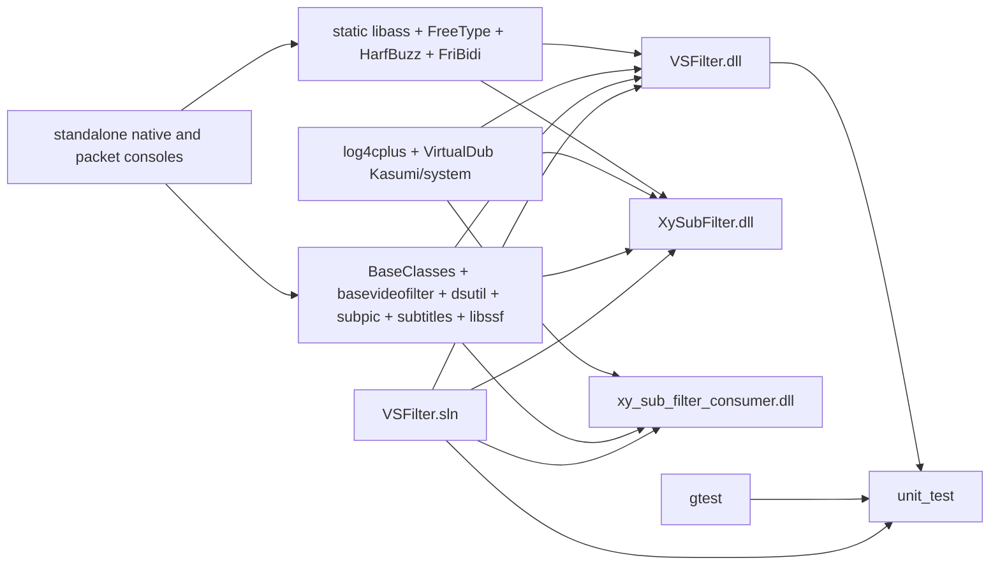
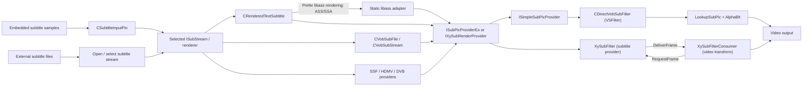

# xy-VSFilter knowledge graph

Scope: the `xy_sub_filter_rc5` branch based on commit `4911cacb102bc0cbd41449793e54473265b04e62`, including local style-hash, ASS parsing/cache, reconstruction/allocation optimizations and benchmark tools. This is a map of the checked-out source, not a claim that every optional format or renderer follows the same path. Edges below describe either solution dependencies or calls and interfaces visible in the linked code.

## Build graph

The arrows into a DLL mean **build dependency**. The shared-library grouping condenses the repeated `ProjectDependencies` entries in [VSFilter.sln](../VSFilter.sln); it does not imply one physical library. The DLL target names and source membership are in [VSFilter.vcxproj](../src/filters/transform/vsfilter/VSFilter.vcxproj), [xy_sub_filter.vcxproj](../src/filters/transform/vsfilter/xy_sub_filter.vcxproj), and [xy_sub_filter_consumer.vcxproj](../src/filters/transform/vsfilter/xy_sub_filter_consumer.vcxproj). The unit test project is [unit_test.vcxproj](../test/unit_test/unit_test.vcxproj).

Release **v3.2.1.920** is defined in [version_in.h](../src/filters/transform/vsfilter/version_in.h), shared by DLL resources and filter options. CI passes `--versioning-off` so the committed release number is preserved. See [release notes](releases/v3.2.1.920.md) and the preceding [v3.2.1.910 notes](releases/v3.2.1.910.md).

## Runtime graph

The format nodes are alternatives: a selected `ISubStream` represents one subtitle source. The VSFilter and XySubFilter branches are distinct integration paths, although they share parsing, rendering, and options code.

## Nodes and relationships

| Node | Role and outgoing relationship | Primary evidence |
| --- | --- | --- |
| `VSFilter.dll` | DirectShow video transform and Avisynth/CSRI entry points; uses the shared subtitle and subpicture code. | [DirectVobSubFilter.h](../src/filters/transform/vsfilter/DirectVobSubFilter.h), [plugins.cpp](../src/filters/transform/vsfilter/plugins.cpp), [csriapi.cpp](../src/filters/transform/vsfilter/csriapi.cpp) |
| `XySubFilter.dll` | Subtitle provider filter; chooses an `ISubStream`, adapts it to `IXySubRenderProvider`, and sends frames to a consumer. | [xy_sub_filter.h](../src/filters/transform/vsfilter/xy_sub_filter.h), [xy_sub_filter.cpp](../src/filters/transform/vsfilter/xy_sub_filter.cpp) (`SetSubtitle`, `RequestFrame`) |
| `xy_sub_filter_consumer.dll` | Video transform that requests a subtitle frame from `ISubRenderProvider`, receives `DeliverFrame`, and blends the result. | [xy_sub_filter_consumer.h](../src/filters/transform/vsfilter/xy_sub_filter_consumer.h), [xy_sub_filter_consumer.cpp](../src/filters/transform/vsfilter/xy_sub_filter_consumer.cpp) (`Transform`, `DeliverFrame`, `AlphaBlt`) |
| `CSubtitleInputPin` | Accepts embedded subtitle media samples and creates format-specific helpers and streams. | [SubtitleInputPin.h](../src/subtitles/SubtitleInputPin.h), [SubtitleInputPin.cpp](../src/subtitles/SubtitleInputPin.cpp) (`CreateHelper`, `Receive`) |
| `CRenderedTextSubtitle` | Parses and renders text subtitles, including SSA/ASS and WebVTT paths. Implements subtitle stream and subpicture provider interfaces. | [STS.h](../src/subtitles/STS.h), [RTS.h](../src/subtitles/RTS.h), [RTS.cpp](../src/subtitles/RTS.cpp) |
| Optional libass backend | Both filter Main pages persist an unchecked-by-default preference. The shared text renderer retains original ASS/SSA input, streams embedded headers/events and graph font attachments into libass, and composites ordered masks into owned existing-format frames. Native remains the path for other formats and extended embedded ASS2. Libass, FreeType, HarfBuzz and FriBidi are linked statically from pinned source archives. | [integration](libass-integration.md), [LibassRenderer.cpp](../src/subtitles/LibassRenderer.cpp), [build inputs](../src/thirdparty/libass-deps/sources.lock.json) |
| Bitmap/other subtitle providers | VobSub, SSF, HDMV/PGS, and DVB processing provide other stream/render paths. | [VobSubFile.h](../src/subtitles/VobSubFile.h), [SSF.h](../src/subtitles/SSF.h), [HdmvSub.h](../src/subtitles/HdmvSub.h), [DVBSub.h](../src/subtitles/DVBSub.h), [hdmv_subtitle_provider.h](../src/subtitles/hdmv_subtitle_provider.h) |
| Subpicture abstraction | `ISubPicProvider`, `ISubPicProviderEx`, `ISubPicQueue`, `ISubPic`, and `SubPicDesc` connect renderers to buffers and blending. | [ISubPic.h](../src/subpic/ISubPic.h), [SubPicProviderImpl.h](../src/subpic/SubPicProviderImpl.h), [SubPicQueueImpl.h](../src/subpic/SubPicQueueImpl.h) |
| Compatibility adapters | `SimpleSubPicProvider` services VSFilter lookups; `XySubRenderProviderWrapper` adapts subpicture providers for XySubFilter. | [SimpleSubPicProviderImpl.h](../src/subpic/SimpleSubPicProviderImpl.h), [XySubRenderProviderWrapper.h](../src/subpic/XySubRenderProviderWrapper.h) |
| Layout settings and render admission | Both More pages stage layout edits for Apply/OK. `BIN2_RENDER_LAYOUT` commits mode, size and original-size policy together; custom API/registry sizes share validation. The native wrapper keeps selected layout separate from actual original-video/output size and combines only occupied bounds, preserving negotiated alpha. Bitmap and blur allocation/work checks fail before unsafe arithmetic or allocation. | [options/page](../src/filters/transform/vsfilter/DirectVobSubPropPage.cpp), [limits](../src/subtitles/RenderLimits.h), [wrapper](../src/subpic/XySubRenderProviderWrapper.cpp), [implementation and tests](render-layout-fixes-20261030.md) |
| Consumer invalidation | XySubFilter's existing worker dispatches optional `ISubRenderConsumer2::Clear` outside renderer locks. `ConsumerInvalidation` coalesces pending requests and reschedules when old delivery races an invalidation; retained frame storage stays immutable. | [queue state](../src/subpic/ConsumerInvalidation.h), [filter/worker](../src/filters/transform/vsfilter/xy_sub_filter.cpp), [regression contracts](../test/benchmark/layout_contract.h) |
| Shared infrastructure | DirectShow media utilities, base video transform, options/property pages, and COM registration support the DLLs. | [dsutil](../src/dsutil), [BaseVideoFilter.h](../src/filters/transform/basevideofilter/BaseVideoFilter.h), [DirectVobSub.h](../src/filters/transform/vsfilter/DirectVobSub.h), [VSFilter.cpp](../src/filters/transform/vsfilter/VSFilter.cpp) |
| Style sharing and hashes | `CRenderedTextSubtitle::GetSubtitle` resolves cached states; `CreateSubtitle` creates `FwSTSStyle` values on misses. Boost's shared style table uses `STSStyle::operator==` and `hash_value(STSStyle)`; every equality field participates in the hash. The common double hash canonicalizes signed zero. This code is shared by both runtime paths. | [STS.h](../src/subtitles/STS.h), [STS.cpp](../src/subtitles/STS.cpp), [flyweight_base_types.h](../src/subtitles/flyweight_base_types.h), [RTS.cpp](../src/subtitles/RTS.cpp) |
| ASS command recognition | `LookupAssCommand` builds a compact immutable trie once from the existing command vocabulary. Tokenization searches UTF-16 source spans without creating command/prefix strings; it preserves the legacy longest case-sensitive match and copies parameter values into their existing owned strings. `AssTagParams` keeps the first owned argument inline with a count and lazy spill pointer. Multi-argument spills combine their capacity header and slots in one allocation. `AssTagList` has a lazy packed-node owner, with stable node addresses and no per-scalar nested-list allocation. Syntax admission charges actual block/spill/string capacity and conservative owner/allocator overhead. Numeric conversion, transform evaluation and the syntax/reconstruction admissions are bounded separately (currently 64 MiB each). | [RTS.cpp](../src/subtitles/RTS.cpp), [RTS.h](../src/subtitles/RTS.h), [differential contract](../test/benchmark/render_subtitles.cpp), [prefix fixture](../test/benchmark/fixtures/ass-command-prefixes.ass) |
| Active ASS syntax and text | `GetSubtitle` retains immutable tag blocks, tag/text boundaries and the following raw text with active and upcoming animated events under a default 64 MiB accounted-memory admission limit. A source cursor avoids rebuilding suffix strings on misses. `ExpireParsedTags` releases ended events and resets on backward seeks; text comparison and `OnChanged`/`Deinit` invalidate stale syntax. Cache misses use the existing shared MRU. Numeric conversion is cached while animation evaluation still runs at each timestamp. | [RTS.h](../src/subtitles/RTS.h), [RTS.cpp](../src/subtitles/RTS.cpp), [cache_manager.h](../src/subtitles/cache_manager.h) |
| Frame assembly and ownership | `RenderOneSubtitle` appends final draw-item slots, and `CLine::PaintAll` fills the specified range. `XyFlyWeight` can borrow a value for lookup and retain an owned value on a miss. `DrawItem` and overlay factories return shared ownership directly, allowing combined allocations. Word factories use combined shared allocations, and grouped keys and grouped draw-item sequences keep the first child inline. Frame grouping uses one contiguous item-metadata array and event-range views; initial memberships live inline in each item and merged memberships borrow address-stable frame-owned lists. All temporary memberships use inline-first pointer sequences, rectangle IDs keep eight entries inline before spilling, and each final draw sequence reserves its counted layer slots before filling. Normal x86 grouped bitmap-key lookups use a synchronous view of the frame's child draws; x64 keeps owned snapshots unless the build experiment is explicitly enabled; public key copy/assignment materializes immutable owned children before a cache can retain them. The existing CreateHashKey API remains owning. The lookup view is compiled and has passed its ownership contract; full offline comparisons are recorded with the libass/console follow-up. Matching fractional layer positions share immutable geometry keys and painted overlay machines; opaque-box geometry stays distinct from the body. Only requested layers receive keys; dirty-rectangle queries reuse a painted overlay, and unclipped subtitles share a stateless clipper machine. | [RTS.cpp](../src/subtitles/RTS.cpp), [flyweight_base_types.h](../src/subtitles/flyweight_base_types.h), [draw_item.cpp](../src/subtitles/draw_item.cpp), [xy_overlay_paint_machine.cpp](../src/subtitles/xy_overlay_paint_machine.cpp) |
| Polygon geometry reuse | `CPolygon::ParseStr` retains the immutable raw-path owner from the existing bounded `PathDataMruCache`, avoiding fresh vertex arrays. Polygon keys omit font glyph fields; text keys retain them. Reuse requires exact nonzero script scales; current baseline and font-scale metrics are recomputed by `UpdateMetrics`. The cached path stays untransformed and immutable; `PaintFromPathData` transforms a separate copy. | [RTS.cpp](../src/subtitles/RTS.cpp), [cache_manager.h](../src/subtitles/cache_manager.h), [geometry contract](../test/benchmark/render_subtitles.cpp) |
| Word and line storage | `CSubtitle` and `CLine` use `CInlineList`: one element is stored directly, with vector storage for longer sequences. `CLine::Compact` merges text in place and retains single words or polygons without cloning them. The first line and first effect are stored inside `CSubtitle`; extra lines/effects have separate ownership. Line iteration uses an opaque index position. | [RTS.h](../src/subtitles/RTS.h), [RTS.cpp](../src/subtitles/RTS.cpp), [ownership contract](../test/benchmark/render_subtitles.cpp) |
| Source/style and single-word layout | `GetSubtitle` uses a small cache-hit path. Unicode entry text is borrowed only during the synchronous call; ANSI text uses the existing conversion with a call-scoped lifetime. Cached states and words still own retained strings. `CreateSubtitle` copy-constructs selected/original styles without default-style initialization, keeping PAR adjustment order. `MakeLines` handles one non-whitespace/non-break word directly with the existing border/metric rounding and shared final rectangle calculation; other cases retain general wrapping/compaction. Read-only traversals and line appends borrow shared-pointer references while the source container remains stable. | [RTS.cpp](../src/subtitles/RTS.cpp), [RTS.h](../src/subtitles/RTS.h), [font/layout contract](../test/benchmark/render_subtitles.cpp), [fixtures](../test/benchmark/fixtures/font-style-layout.ass) |
| Stable reconstruction intervals | `CalcAnimation` intersects the constant intervals before/after evaluated transforms and rejects continuously interpolating state. `GetSubtitle` can retain small single-word text/polygon states (at most 16 polygon vertices, bounded strings, no vector/scroll/origin clipper) for that exact interval. Source identity, duration and interval checks guard reuse. Admission is capped at 16,384 entries and a 64 MiB accounted budget, charging 4 KiB per polygon state or 8 KiB per text state; expiry, backward seeking, edits and deinitialization release states. | [RTS.h](../src/subtitles/RTS.h), [RTS.cpp](../src/subtitles/RTS.cpp), [reconstruction contract](../test/benchmark/render_subtitles.cpp) |
| Per-word key retention | `CWord` holds at most three geometry keys and three draw keys. Geometry reuse requires exact string identity, script scales, style and fractional/transform positions. Draw reuse requires matching fields and hashes, preserving the existing MRU lookup semantics. Eviction replaces ownership rather than mutating a key; keys do not own their parent word or rendered images. | [RTS.h](../src/subtitles/RTS.h), [cache_manager.cpp](../src/subtitles/cache_manager.cpp), [xy_overlay_paint_machine.cpp](../src/subtitles/xy_overlay_paint_machine.cpp), [key contract](../test/benchmark/render_subtitles.cpp) |
| Empty event storage | Each `CRenderedTextSubtitle` owns a `CSubtitlePool` bounded by a compile-time 1 MiB storage budget. Animated events release all old content before their storage is reconstructed for reuse; `OnChanged` and `Deinit` clear the pool. Draw items retain word ownership independently. | [RTS.h](../src/subtitles/RTS.h), [RTS.cpp](../src/subtitles/RTS.cpp), [pool contract](../test/benchmark/render_subtitles.cpp) |
| Final event draw storage | `CompositeDrawItemList` keeps the first shadow/outline/body slot inline and spills additional slots into contiguous storage. Its opaque one-based POSITION indices survive appends; references can move during growth. `RenderOneSubtitle` appends each line/clip region before painting it, and grouping captures element pointers only after `DoRender` has finished all appends. Each list owns its layer references through composition. The outer event list stays ordered. | [draw_item.h](../src/subtitles/draw_item.h), [RTS.cpp](../src/subtitles/RTS.cpp), [inline-list contract](../test/benchmark/render_subtitles.cpp) |
| Composition scratch storage | `CompositeDrawItem::Draw` owns one `AlphaMaskBuffer` for synchronous frame composition. Fallback draws pass it through `DrawItem` into `Rasterizer::CompositeAlphaMask`; packed single-color blending fuses coverage into registers. Temporary masks are consumed synchronously and never retained by output bitmaps or caches. Fully transparent single-color draws preserve bounds and skip their pixel no-op. | [draw_item.cpp](../src/subtitles/draw_item.cpp), [Rasterizer.h](../src/subtitles/Rasterizer.h), [Rasterizer.cpp](../src/subtitles/Rasterizer.cpp) |
| Bitmap capacity and identity | Both filter paths and the Avisynth initializer call `CacheManager::SetBitmapCacheSize` for coupled group-key and payload capacities. A zero-capacity MRU retains nothing and returns no position; flyweights keep owned values with fresh identities on bypass. Draw-key hashing includes all six ordered karaoke switch words used by equality. | [cache_manager.cpp](../src/subtitles/cache_manager.cpp), [mru_cache.h](../src/subtitles/mru_cache.h), [flyweight_base_types.h](../src/subtitles/flyweight_base_types.h), [DirectVobSubFilter.cpp](../src/filters/transform/vsfilter/DirectVobSubFilter.cpp), [xy_sub_filter.cpp](../src/filters/transform/vsfilter/xy_sub_filter.cpp) |
| Native phase diagnostics | Optional per-render phase/work counters are disabled by default and change no COM API. The serial harness can scope an xy_malloc-only allocation probe to RenderEx; it excludes ATL/STL/shared_ptr heap traffic and restores the prior probe before hashing. | [RTS.h](../src/subtitles/RTS.h), [draw_item.cpp](../src/subtitles/draw_item.cpp), [xy_malloc.cpp](../src/subtitles/xy_malloc.cpp), [grouping follow-up](performance-20261026-compact-grouping.md) |
| Edge-blur scratch | Integer edge passes share two operation-local `WORD` rows, reset before each pass. Active `BeBlur` has no image-sized temporary. The legacy fixed-point Gaussian branch keeps the temporary it actually reads. No row scratch escapes the synchronous operation. | [Rasterizer.cpp](../src/subtitles/Rasterizer.cpp), [first review implementation](performance-20261026-review-implementation.md) |
| Build and tests | Windows/Visual Studio solution; Git Bash build script targets VS2019 in CI; tests use Google Test. | [build_vsfilter.sh](../build_vsfilter.sh), [build.yml](../.github/workflows/build.yml), [main.cpp](../test/unit_test/main.cpp) |
| Performance validation | Debug Zoom Player playback captures test the default embedded ASS track, recording actual renderer, engine and dependency hashes. The current full-HD cohort uses MPC Video Renderer; historical smaller-window captures used madVR. A separate native console target supports Win32 and x64 and calls the shared `CRenderedTextSubtitle::RenderEx` directly, hashing every bitmap's position, size and visible pixels for comparison. It also tests style hash distribution and signed zero. | [benchmark README](../test/benchmark/README.md), [render_subtitles.cpp](../test/benchmark/render_subtitles.cpp), [render_subtitles.vcxproj](../test/benchmark/render_subtitles.vcxproj), [analyze_cpu_trace.ps1](../test/benchmark/analyze_cpu_trace.ps1) |

## Follow a change through the graph

- **Subtitle format or parsing:** start at `CSubtitleInputPin::CreateHelper` for embedded media types, then `STS`/`RTS`, `VobSubFile`, `SSF`, `HdmvSub`, or `DVBSub` for the relevant format. Check both filter paths if the rendered result changes.
- **Timing, selected stream, or external file discovery:** trace `Open`, `UpdateSubtitle`, and `SetSubtitle` in [DirectVobSubFilter.cpp](../src/filters/transform/vsfilter/DirectVobSubFilter.cpp) and [xy_sub_filter.cpp](../src/filters/transform/vsfilter/xy_sub_filter.cpp).
- **Pixel format or blending:** trace `SubPicDesc` and `ColorType` in [ISubPic.h](../src/subpic/ISubPic.h), the VSFilter `Transform` path, the consumer `Transform`/`AlphaBlt` path, then relevant tests in [test/unit_test](../test/unit_test).
- **Build or exported DLL behavior:** start with the corresponding `.vcxproj` and DLL entry point (`DirectVobSubFilterDll.cpp`, `xy_sub_filter_dll.cpp`, or `xy_sub_filter_consumer_dll.cpp`). [build_vsfilter.sh](../build_vsfilter.sh) defaults to building `vsfilter xy_sub_filter`; the consumer is a separate solution project.
- **Playback performance:** use `Z:\zpAI\zplayer.exe` and the sample's default subtitle track. The [renderer statistics collector](../test/benchmark/README.md) polls Zoom Player TCP request `1150` and records counter deltas, missing values, and resets.

The [2026-10-23 profiling report](performance-20261023.md) records the first style-hash optimization, pixel-equivalence checks, playback comparison, remaining parser/allocation bottlenecks, and the next proposed optimization.

The [ASS parsing follow-up](performance-20261023-ass.md) records active-event syntax retention, numeric conversion caching, allocation experiments and their validation.

The [x64 and grouping follow-up](performance-20261025-x64-grouping.md) records the resumed tests, explicit engine/registry selection and grouped-draw allocation work.

The [reconstruction and allocation follow-up](performance-20261023-reconstruction.md) records frame-local scratch storage, text-span retention, inline containers and event reuse.

The [first review implementation](performance-20261026-review-implementation.md) records both architecture builds, zero-cache/karaoke contracts, all pixel gates and eight matching Debug playback captures.

When code changes a relationship above, update this map in the same change. Confirm edges against code and project files rather than inferring them from names.

The console now supports complete rendering, isolated parsing/reconstruction,
and composition replay with verified single-CPU affinity and Above Normal
priority. Production parsing/composition functions are used directly; replay
input preparation is outside the timed interval. See the
[benchmark README](../test/benchmark/README.md).

The [libass and native-console report](performance-20261026-libass-native.md) records
static integration, Main-page controls, both-architecture pixel gates, the x86
lookup improvement and the inconclusive complete-render x64 experiment.

The [native inline-storage report](performance-20261026-inline-composite.md)
records the per-event draw-list replacement, x64 ABBA comparisons, ownership
checks and the large multiline/inverse-clip spill fixture.

The [event-parsing report](performance-20261026-event-spikes.md) records
console-only profiling, legacy-prefix differential tests, inline argument
ownership/accounting and fixed-cohort burst measurements.

The [font/style and layout report](performance-20261027-font-layout.md) records
cached-state/source ownership, style initialization, one-word layout and the
Unicode/ANSI legacy-render validation.

The [grouping scratch report](performance-20261027-grouping-scratch.md) records
the frame-owned contiguous metadata array, event-range views, inline initial
memberships and address-stable merged-membership pool in draw_item.cpp.
Scratch pointers are consumed inside CompositeDrawItem::Draw; completed frames
and cached keys retain their existing ownership. Both native runtime adapters
use this shared path.

The [event preparation report](performance-20261027-event-layout.md) records
immutable uniform-span layout/path prototypes in RTS, bounded last-appearance
words and context-guarded static event states. Eligible per-frame paint programs
reuse the existing tag evaluator for color, clips, blur, shadow and transforms
that leave line metrics unchanged. Metric changes, resets and mixed runs retain
legacy construction. Plans follow active-event lifetime and both native adapters.

## General spike-reduction follow-up, 2026-10-27

Both native filter adapters share the changes recorded in the
[spike-reduction report](performance-20261027-spike-paths.md):

- `ParseScript` compares source membership, layer and read order before reusing
  the previous qsort result. Two bounded trivial arrays retain at most 32,768
  events; larger sets use call-local storage. TIME-mode syntax/subtitle expiry
  scans run when an admitted entry can end; FRAME mode retains per-call checks.
  Edits, seeks and deinitialization reset the relevant state.
- `RenderEx` can prepare upcoming events synchronously inside its timed call,
  after current output is created, or on a blank request. A one-second horizon,
  a 4 ms allowance and 75% frame-period headroom govern traversal. A source event
  is a non-preemptible unit, so that allowance is not a hard elapsed-time bound.
  Only completely context-guarded prepared states remain cached; unsupported
  construction is recycled. Actual-time evaluation and legacy fallbacks remain.
- Default active syntax admission is 64 MiB, reconstructed states 64 MiB/16,384
  entries, and immutable layouts 32 MiB. The empty event pool stays below 1 MiB.
  These are separate ownership/admission policies, not a process-RSS ceiling.
- `CreatePaintMachines` makes one shared allocation containing the word machine
  and its layer wrappers. Returned aliases own that allocation; embedded layer
  wrappers borrow the parent and create no ownership cycle. Grouping removes
  duplicate vertical boundaries before constructing its existing ATL bands.
- `XyAtlMap`/`XyMru::FindOrAddOwned` accept a borrowed lookup key and invoke an
  owning factory only after a single bucket traversal misses. Flyweight IDs,
  zero-capacity bypass, MRU ordering and retained-key ownership are preserved.
- `CClipperPaintMachine` holds only a weak painted-mask reference. Repeated
  paints avoid another global lookup while a bounded MRU/caller owns the mask;
  eviction can release it normally. Sparse inverse masks and tighter bounds
  are separate pending work.
- `Rasterizer::DrawSingleColorFused` performs exact fixed-point mask generation
  and packed single-color alpha blending without an intermediate alpha image.
  SSE2 endpoint cases preserve alpha conventions and clipping. Planar,
  multicolor and additive paths use the existing code.

The console prints maintenance and lookahead counters; full-render timings
include preparation while the nested parse phase excludes lookahead. Six new
contracts and `spike-bursts.ass` exercise general timing, ownership and pixel
behavior. No filename, title, timestamp or named-style recognition is present
in production eligibility. No playback is run for this follow-up.

The separate [streaming packet probe](../test/benchmark/streaming_subtitles.cpp)
uses the native harness's scheduling/font/hash helpers and the same shared
renderer library. Its [project](../test/benchmark/streaming_subtitles.vcxproj)
is built directly. It removes native future entries, then times chronological
`Add`/segmentation and `RenderEx` under simulated packet lead. The
[runner](../test/benchmark/run_packet_benchmark.py) isolates lookahead on/off,
checks complete frame hashes against full-script gold and distinguishes this
model from observed DirectShow delivery. Results belong in the spike report.

## Retained preparation and draw descriptors (2026-10-27)

The [top-three implementation report](performance-20261027-top-three.md) follows
[the spike review](ass-spike-optimization-review-20261027.md). These changes are
in the shared native renderer used by both DirectVobSub and XySubFilter; the
optional libass path bypasses them.

- `HasLayoutAnimation` and paint-only tag replay in `RTS.cpp` admit `CMD_p` and
  `CMD_pbo` because the existing evaluator assigns them independently of transform
  time. The prepared plan still checks the resulting mode/baseline exactly.
- `PrepareStaticDrawing` retains eligible staged polygon words and immutable
  vertices under the existing 64 MiB reconstruction budget. `MatchesPreparedContext`
  validates source, style, duration, effect, margins, PAR and screen context before
  activation. Collision placement remains in `ParseScript`. The 8,192-character
  lookahead cutoff is unchanged. `CPolygon::ParseStr` scans command spans while
  retaining the old command splitting, `wcstod`, scaling and rounding rules.
- `CLine::PaintAll` can retain `PreparedLineDraw` for a cached single-word line
  without motion, fading, scrolling, inverse/vector clipping or karaoke. Exact
  word/style, position/origin/margin, clip, alpha, metrics, target scale, subpixel
  level and output color context guard reuse. Appearance or placement changes
  take the original factory path. `CLine::Empty` releases retained descriptors.
- Each `DrawReuseLease` charges 4 KiB of metadata under a separate 32 MiB renderer
  budget. A descriptor or an outstanding draw reference keeps its charge alive.
  `DrawItem::SealBounds` retains successful exact dirty bounds; layer wrappers use
  weak raster references after admission. `FrameOverlayPin` holds strong raster
  owners only during composition, then releases them; existing MRUs still govern
  retention across requests.
  `CWordPaintMachine` reuses true-subpixel keys and builds a distinct quantized key
  when necessary. Ordinary machine/draw/key factory counters supplement `xy_malloc`.
- Additive blend selection belongs to `CompositeDrawItem` and grouped per-frame
  flags; composition does not mutate retained `DrawItem` descriptors. Grouping,
  layer order, bitmap partitioning and blend arithmetic remain the same.

The native console has focused `constant-drawing`, `static-drawing`,
`polygon-scanner` and `draw-reuse` contracts, plus the independent
[prepared/draw reuse fixture](../test/benchmark/fixtures/prepared-draw-reuse.ass).
The scanner contract compares 2,000 inputs to the frozen legacy implementation.

## Zero-lead scalar parameter reuse (2026-10-27)

The [zero-lead follow-up](performance-20261027-zero-lead.md) targets parsing on
the actual activation request. `GetParsedSSATags` and the syntax-parser overload
of `ParseSSATag` are instance methods so their cold path can use a renderer-owned
`ScalarParameterCache`. Complete override programs still use the existing global
MRU; this additional cache reuses common scalar parameters across different
programs without changing `AssTag` storage or the existing parser grammar.

The cache has 512 direct-mapped slots and accepts at most 128 UTF-16 characters
per raw scalar parameter. Every hit checks command identity and the complete raw
span; hashes never replace equality. Slots own the raw key, trimmed/owned
parameter CString and, for invariant ASCII numeric spellings, the exact cached
first numeric union value. Real-valued commands only cache integral tokens
with magnitude at most 65,535; integer/hex commands keep their original bases.
CString copy on write preserves earlier AST owners when a slot is replaced. Parenthesized
forms and oversized spans take the original parsing path.
No source filename, style name, shape or timestamp identifies an eligible input.

Fractional, scientific, larger real and noncanonical forms reuse only the owned
string; they run the original CRT conversion in the current locale and FP
environment. Small integral real values are exact at every supported precision;
signed zero is copied from the original CRT result. Eligibility never substitutes
its own numeric value or changes the original integer/hex conversion bases.
Named/default style resets are still resolved by the evaluator.
`OnChanged` releases the cache. Storage stays below 512 KiB per renderer,
separate from existing event/layout/image budgets. Optional libass bypasses it.

The `scalar-parameter` contract covers shared values, 1,200 distinct programs,
collisions/eviction, ownership, context changes, legacy syntax and retained frames.
The independent [scalar fixture](../test/benchmark/fixtures/scalar-parameters.ass)
is compared with the preceding build. The packet console has optional phase,
work-counter and feature-disable switches; default timing retains the original
packet-insertion-plus-RenderEx scope and one Above Normal rendering thread.

## Compact cold ASS storage (2026-10-28)

`AssTagList` in [RTS.h](../src/subtitles/RTS.h) now occupies one pointer.
[RTS.cpp](../src/subtitles/RTS.cpp) lazily allocates a header plus eight nodes,
then sixteen-node blocks. Nodes never move. Linked iteration and child command
order remain unchanged; nested lists allocate only when populated. Ownership
follows the immutable program's shared lifetime, without a global arena or pool.
`GetParsedSSATags` uses a combined shared allocation for the outer list/control
owner and publishes it only after successful parsing.

`AssTagParams` keeps its first owned CString inline. Its optional allocation
contains a capacity header and raw spill slots; only live strings are constructed.
First spill reserves three additional slots, covering two-to-four-argument forms
with one allocation; larger argument lists grow geometrically. Alias-safe growth,
truncation, source ownership and empty-argument behavior preserve the existing
container contract. Numeric unions and their separate spill arrays, command
recognition, first-closing-parenthesis grammar and CRT conversions are unchanged.

`EstimateTagMemory` charges actual allocated node/spill capacity, retained CString
capacity and conservative shared-owner/allocator bookkeeping. Syntax admission
stays 64 MiB; reconstruction, layout and raster budgets are unchanged. Smaller
accounted programs can fit more entries within that same admission. Process
commit is measured separately. Both native adapters use this shared parser;
optional libass bypasses it.

The `tag-storage` contract covers aliasing, reserve/truncate/refill, nested
programs, 5,000 stable tag addresses, numeric spills and retained program owners.
The independent [storage fixture](../test/benchmark/fixtures/tag-storage.ass)
contains 100 events and exercises short/long programs and legacy parameter forms.

See [the cold-storage implementation/results](performance-20261028-tag-storage.md) for repeated timings, memory, rejected alternatives and exact-output gates.
